# Improved Dung Beetle Algorithm, reproduced from a paper in the first-tier journal of the Chinese Academy of Sciences, using Fuch mapping + backpropagation + adaptive step size + random differential mutation, MATLAB code.

This article reproduces an improved dung beetle optimization algorithm published in the top journal of CAS No.1 Category, "Energy" in 2024.
The paper is cited as follows:
Li Y, Sun K, Yao Q, et al. A dual-optimization wind speed forecasting model based on deep learning and improved dung beetle optimization algorithm[J]. Energy, 2024, 286: 129604.
The principle of the improved dung beetle optimization algorithm is as follows:
Improvement strategy:
Point 1: Integrate Fuch chaotic with reverse learning strategy for population initialization
Population initialization is randomly generated in DBO, which can lead to uneven distribution of the initial population, resulting in diversity of the initial population. By integrating chaotic and reverse learning strategies for population initialization, we combine the chaotic initialization method and reverse learning initialization strategy to improve the convergence speed of DBO.
The Fuch chaotic mapping formula is as follows:
While generating initial solutions using the Fuch chaotic mapping, a reverse learning strategy is introduced. This expands the search space of the dung beetles, thereby improving the quality of the initial solution for the population. The mathematical expression of the reverse learning strategy is shown below:
In which OPi represents the inverse solution corresponding to each initial solution Pi. Pmax and Pmin represent the maximum and minimum values in the initial solution respectively. K is a random value within the range (0, 1).
Improvement point 2: Integrate adaptive step size strategy with convex lens imaging strategy
Since DBO uses random strategies, it lacks adaptability during the dung beetle foraging phase and has weak global search capability, easily falling into local optima. To further improve the algorithm's path finding performance, this article adopts a dynamic selection strategy, alternating between the adaptive step size strategy and the convex lens imaging inversion strategy to update the target position at a certain probability.
In the initial iterations, a large step size allows for expansive foraging search, enhancing the algorithm's global search capability and promoting faster convergence to better solutions. In later iterations, a small step size is beneficial for local search in the algorithm. The pattern of step size variation guides the search from a global to a local one, as seen in the foraging behavior of Dung Beetle. This strategy is primarily controlled by the adaptive step-size factor α0, which is linearly decreasing:

Additionally, a convex lens imaging learning strategy is introduced to perturb the Dung Beetle population, aiming to enhance diversity and increase the likelihood of the algorithm escaping local optima. This equation is represented as follows:
This strategy has been extensively detailed in previous proposed improvements to the MSCSO (Sand Cat Optimization Algorithm). For specific details, please refer to: Three Strategies for Improving the Sand Cat Optimization Algorithm (MSCSO)
The choice of the strategy for updating the target position is determined by the selection probability Ps. When Ps<0.5, random step-size strategy is used for position update; otherwise, the convex lens reverse learning strategy is applied, as shown in the following equation:
Improvement point 3: Random differential mutation strategy
The position update equation for Dung Beetle stealing behavior updates based on the current optimal value of an individual, which can lead to a decrease in population diversity and potentially trap the algorithm in a local optimum state, resulting in low convergence accuracy and efficiency. Therefore, this paper introduces a random differential mutation strategy to enhance the diversity of the Dung Beetle population. The formula is as follows:
where P (t+1) represents new individuals obtained through random differential mutation, r1 and r2 are random values between [0,1], and P∗ is the current best individual position. P′(t) is the position of an individual randomly selected from the population.
Results show
Tested on the CEC2005 function set and compared with original Dung Beetle algorithms (DBO), RIMEA (RIME), Pelican Algorithm (POA), Grey Wolf Optimization Algorithm (GWO), and Particle Swarm Optimization Algorithm (PSO).
Please draw the function image, iterative curve, particle trajectory graph, average convergence graph and historical position graph. These figures are often involved in many intelligent algorithm literatures.
Tested at CEC2005:
F1:
F2:
F5:
F6:
F7:
F8:
F12:
F13:
The above images can be generated by running the code.
CEC2005 indicator statistics are as follows:
Each algorithm is tested 500 times, the population size is set to 30, each function runs 30 times, the optimal value, standard deviation, mean, worst value, median are calculated. The rank sum test results, box plots, etc. are shown as follows.
F1Function calculation results: \nIDBO: Optimal value:0 Standard deviation:0 Mean:9.6862e-212 Median:1.8438e-315 Worst value:2.9059e-210\nDBO: Optimal value:5.6605e-160 Standard deviation:3.3056e-101 Mean:6.0352e-102 Median:7.2493e-137 Worst value:1.8106e-100\nPOA: Optimal value:2.3045e-124 Standard deviation:2.0159e-107 Mean:4.7334e-108 Median:1.5882e-112 Worst value:1.0942e-106\nRIME: Optimal value:0.001256 Standard deviation:0.017157 Mean:0.024137 Median:0.019496 Worst value:0.073224\nGWO: Optimal value:1.2459e-62 Standard deviation:1.506e-56 Mean:3.7062e-57 Median:1.8814e-58 Worst value:8.2617e-56\nPSO: Optimal value:5.6064e-12 Standard deviation:2.1444e-10 Mean:2.4496e-10 Median:1.869e-10 Worst value:8.0208e-10\nF2Function calculation results: \nIDBO: Optimal value:1.0557e-173 Standard deviation:2.7163e-106 Mean:7.3092e-107 Median:7.2481e-118 Worst value:1.2939e-105\nDBO: Optimal value:1.19e-89 Standard deviation:1.2629e-49 Average:2.3381e-50 Median:1.2266e-70 Worst value:6.9199e-49\nPOA: Optimal value:2.1959e-63 Standard deviation:5.1701e-53 Mean:1.2445e-53 Median:1.1003e-56 Worst value:2.7864e-52\nRIME: Optimal value:0.010449 Standard deviation:0.012761 Mean:0.027399 Median:0.025248 Worst value:0.061068\nGWO: Optimal value:3.6703e-35 Standard deviation:8.6679e-33 Mean:5.4424e-33 Median:2.4603e-33 Worst value:4.343e-32\nPSO: Optimal value:1.6184e-07 Standard deviation:2.2715e-06 Mean:1.5497e-06 Median:8.612e-07 Worst value:1.2125e-05\nF3Function calculation results: \nIDBO: Optimal value:8.8148e-306 Standard deviation:8.663e-147 Mean:1.9993e-147 Median:2.1029e-159 Worst value:4.6474e-146\nDBO: Optimal value:2.9335e-166 Standard deviation:3.3776e-92 Mean:6.1703e-93 Median:2.1864e-114 Worst value:1.85e-91\nPOA: Optimal value:1.3797e-118 Standard deviation:1.0378e-104 Mean:2.7758e-105 Median:6.073e-111 Worst value:4.1843e-104\nRIME: Optimal value:0.10179 Standard deviation:0.35031 Mean:0.50535 Median:0.40091 Worst value:1.4073\nGWO: Optimal value:5.8196e-31 Standard deviation:1.2364e-24 Mean:4.8272e-25 Median:1.2257e-26 Worst value:5.4387e-24\nPSO: Optimal value:5.466e-05 Standard deviation:0.0022693 Mean:0.0020178 Median:0.00093838 Worst value:0.0070596\nF4Function calculation results: \nIDBO: Optimal value:3.4084e-172 Standard deviation:1.8247e-87 Mean:3.3315e-88 Median:1.3633e-157 Worst value:9.9944e-87\nDBO: Optimal value:6.8734e-77 Standard deviation:1.1975e-47 Mean:2.4789e-48 Median:6.4907e-66 Worst value:6.5271e-47\nPOA: Optimal value:1.1764e-60 Standard deviation:8.7436e-52 Mean:2.3978e-52 Median:1.908e-55 Worst value:4.1033e-51\nRIME: Optimal value:0.028983 Standard deviation:0.070491 Mean:0.17738 Median:0.17562 Worst value:0.40332\nGWO: Optimal value:2.1966e-20 Standard deviation:3.3561e-18 Mean:2.0867e-18 Median:1.2651e-18 Worst value:1.7374e-17\nPSO: Optimal value:0.00014318 Standard deviation:0.0018738 Mean:0.0017881 Median:0.0012939 Worst value:0.01012\nF5Function calculation results: \nIDBO: Optimal value:3.3744e-10 Standard deviation:2.6766 Mean:2.1129 Median:0.00054869 Worst value:5.9616\nDBO: Optimal value:4.9322 Standard deviation:0.25413 Mean:5.3329 Median:5.3066 Worst value:5.8435\nPOA: Optimal value:5.2964 Standard deviation:0.62048 Mean:6.3854 Median:6.2605 Worst value:7.5541\nRIME: Optimal value:2.4451 Standard deviation:95.3281 Mean:62.8529 Median:17.2105 Worst value:397.1781\nGWO: Optimal value:5.6837 Standard deviation:0.50977 Mean:6.5998 Median:6.2575 Worst value:7.2276\nPSO: Optimal value:0.079247 Standard deviation:764.1423 Mean:210.4998 Median:5.6396 Worst value:3020.73\nF6Function calculation results: \nIDBO: Optimal value:8.9363e-32 Standard deviation:1.6928e-24 Mean:3.3397e-25 Median:6.5782e-28 Worst value:9.2864e-24\nDBO: Optimal value:2.0245e-30 Standard deviation:1.9387e-23 Mean:5.0326e-24 Median:9.4085e-26 Worst value:1.0096e-22\nPOA: Optimal value:9.5254e-07 Standard deviation:0.098336 Mean:0.051839 Median:2.8711e-06 Worst value:0.25666\nRIME: Optimal value:0.0013626 Standard deviation:0.014849 Mean:0.018724 Median:0.013838 Worst value:0.05142\nGWO: Optimal value:1.5983e-06 Standard deviation:0.04594 Mean:0.0083907 Median:3.14e-06 Worst value:0.25163\nPSO: Optimal value:9.5314e-12 Standard deviation:1.2313e-09 Mean:5.8171e-10 Median:1.4647e-10 Worst value:5.1335e-09\nF7Function calculation results: \nIDBO: Optimal value:7.3807e-06 Standard deviation:0.00012974 Mean:0.00018304 Median:0.00015625 Worst value:0.00055443\nDBO: Optimal value:0.00026051 Standard deviation:0.00085674 Mean:0.0011225 Median:0.00088427 Worst value:0.0038473\nPOA: Optimal value:2.8649e-05 Standard deviation:0.00010243 Mean:0.00015893 Median:0.00015159 Worst value:0.00037197\nRIME: Optimal value:0.001078 Standard deviation:0.0019118 Mean:0.0031863 Median:0.0025373 Worst value:0.0082845\nGWO: Optimal value:7.2974e-05 Standard deviation:0.0004126 Mean:0.00058054 Median:0.00047977 Worst value:0.001418\nPSO: Optimal value:0.00083596 Standard deviation:0.0011913 Mean:0.0029738 Median:0.003273 Worst value:0.0054277\nF8Function calculation results: \nIDBO: Optimal value:-4189.8289 Standard deviation:341.2354 Mean:-3923.7854 Median:-4061.6432 Worst value:-2997.8602\nDBO: Optimal value:-4189.8289 Standard deviation:469.6195 Mean:-3385.5902 Median:-3339.2994 Worst value:-2641.0282\nPOA: Optimal value:-3478.7982 Standard deviation:186.2891 Mean:-3042.4312 Median:-3059.9097 Worst value:-2684.0164\nRIME: Optimal value:-4071.3751 Standard deviation:154.0057 Mean:-3900.2185 Median:-3952.8522 Worst value:-3479.01\nGWO: Optimal value:-3518.5805 Standard deviation:398.5263 Mean:-2747.5579 Median:-2772.4435 Worst value:-2148.2888\nPSO: Optimal value:-3617.3742 Standard deviation:263.7841 Mean:-2975.0618 Median:-2965.9552 Worst value:-2511.9144\nF9Function calculation results: \nIDBO: Optimal value:0 Standard deviation:0 Mean:0 Median:0 Worst value:0\nDBO: Optimal value:0 Standard deviation:3.0658 Average:0.90048 Median:0 Worst value:15.9193\nPOA: Optimal value:0 Standard deviation:0 Mean:0 Median:0 Worst value:0\nRIME: Optimal value:0.0029538 Standard deviation:1.6902 Mean:2.863 Median:2.9888 Worst value:6.9678\nGWO: Optimal value:0 Standard deviation:1.4768 Mean:0.78374 Median:0 Worst value:4.4834\nPSO: Optimal value:1.99 Standard deviation:2.8726 Average:6.7157 Median:6.4743 Worst value:13.9294\nF10Function calculation results: \nIDBO: Optimal value:4.4409e-16 Standard deviation:0 Mean:4.4409e-16 Median:4.4409e-16 Worst value:4.4409e-16\nDBO: Optimal value:4.4409e-16 Standard deviation:0 Mean:4.4409e-16 Median:4.4409e-16 Worst value:4.4409e-16\nPOA: Optimal value:4.4409e-16 Standard deviation:1.5979e-15 Mean:3.0494e-15 Median:3.9968e-15 Worst value:3.9968e-15\nRIME: Optimal value:0.028095 Standard deviation:0.02511 Mean:0.061136 Median:0.054543 Worst value:0.13749\nGWO: Optimal value:3.9968e-15 Standard deviation:1.3467e-15 Mean:6.9574e-15 Median:7.5495e-15 Worst value:7.5495e-15\nPSO: Optimal value:8.8838e-07 Standard deviation:5.0736e-06 Mean:6.7866e-06 Median:5.8076e-06 Worst value:2.044e-05\nF11Function calculation results: \nIDBO: Optimal value:0 Standard deviation:0 Mean:0 Median:0 Worst value:0\nDBO: Optimal value:0 Standard deviation:0.030774 Mean:0.010735 Median:0 Worst value:0.1328\nPOA: Optimal value:0 Standard deviation:0 Mean:0 Median:0 Worst value:0\nRIME: Optimal value:0.046933 Standard deviation:0.087513 Mean:0.19999 Median:0.17363 Worst value:0.50778\nGWO: Optimal value:0 Standard deviation:0.017619 Mean:0.020812 Median:0.021356 Worst value:0.0774\nPSO: Optimal value:0.029579 Standard deviation:0.072136 Average:0.11052 Median:0.093109 Worst value:0.32049\nF12Function calculation results: \nIDBO: Optimal value:5.7765e-32 Standard deviation:8.4403e-26 Mean:3.0725e-26 Median:1.3505e-28 Worst value:4.1451e-25\nDBO: Optimal value:4.7186e-31 Standard deviation:3.3683e-11 Average:6.7187e-12 Median:2.1e-25 Worst value:1.847e-10\nPOA: Optimal value:9.611e-07 Standard deviation:0.059516 Mean:0.025787 Median:0.017673 Worst value:0.33346\nRIME: Optimal value:3.7307e-05 Standard deviation:0.00016285 Mean:0.00023748 Median:0.00021144 Worst value:0.00059381\nGWO: Optimal value:3.8696e-07 Standard deviation:0.008893 Mean:0.0052737 Median:1.6643e-06 Worst value:0.0201\nPSO: Optimal value:1.9617e-13 Standard deviation:3.2109e-11 Mean:1.6285e-11 Median:5.7721e-12 Worst value:1.5334e-10\nF13Function calculation results: \nIDBO: Optimal value:3.5506e-31 Standard deviation:0.0049376 Mean:0.0017995 Median:3.1559e-27 Worst value:0.021024\nDBO: Optimal value:1.6398e-28 Standard deviation:0.043648 Mean:0.022922 Median:4.9161e-20 Worst value:0.14132\nPOA: Optimal value:2.6235e-06 Standard deviation:0.21971 Mean:0.30092 Median:0.25007 Worst value:0.86165\nRIME: Optimal value:8.9776e-05 Standard deviation:0.0035563 Mean:0.0019783 Median:0.00081764 Worst value:0.013139\nGWO: Optimal value:2.7746e-06 Standard deviation:0.050276 Mean:0.023377 Median:8.2744e-06 Worst value:0.19718\nPSO: Optimal value:4.9108e-12 Standard deviation:1.0538e-08 Mean:2.0744e-09 Median:2.2623e-11 Worst value:5.7824e-08\nF14Function calculation results: \nIDBO: Optimal value:0.998 Standard deviation:0.19308 Mean:1.0444 Median:0.998 Worst value:1.992\nDBO: Optimal value:0.998 Standard deviation:0.71287 Mean:1.362 Median:0.998 Worst value:2.9821\nPOA: Optimal value:0.998 Standard deviation:0 Mean:0.998 Median:0.998 Worst value:0.998\nRIME: Optimal value:0.998 Standard deviation:3.5407e-12 Mean:0.998 Median:0.998 Worst value:0.998\nGWO: Optimal value:0.998 Standard deviation:3.7747 Mean:3.9074 Median:2.9821 Worst value:12.6705\nPSO: Optimal value:0.998 Standard deviation:2.685 Mean:1.5805 Median:0.998 Worst value:15.5038\nF15Function calculation results: \nIDBO: Optimal value:0.00030749 Standard deviation:0.00022115 Mean:0.00039727 Median:0.00031821 Worst value:0.0014887\nDBO: Optimal value:0.00030749 Standard deviation:0.00034146 Mean:0.00067266 Median:0.00066197 Worst value:0.0014894\nPOA: Optimal value:0.00030749 Standard deviation:0.0036596 Mean:0.00098779 Median:0.00030749 Worst value:0.020363\nRIME: Optimal value:0.000372 Standard deviation:0.0095987 Mean:0.0084209 Median:0.00077061 Worst value:0.020364\nGWO: Optimal value:0.00030754 Standard deviation:0.0075709 Mean:0.0037227 Median:0.00037613 Worst value:0.020363\nPSO: Optimal value:0.00030751 Standard deviation:0.0060404 Mean:0.0025911 Median:0.00042301 Worst value:0.020363\nF16Function calculation results: \nIDBO: Optimal value:-1.0316 Standard deviation:5.8312e-16 Mean:-1.0316 Median:-1.0316 Worst value:-1.0316\nDBO: Optimal value:-1.0316 Standard deviation:5.9752e-16 Mean:-1.0316 Median:-1.0316 Worst value:-1.0316\nPOA: Optimal value:-1.0316 Standard deviation:5.8312e-16 Mean:-1.0316 Median:-1.0316 Worst value:-1.0316\nRIME: Optimal value:-1.0316 Standard deviation:1.9463e-07 Mean:-1.0316 Median:-1.0316 Worst value:-1.0316\nGWO: Optimal value:-1.0316 Standard deviation:3.2869e-08 Mean:-1.0316 Median:-1.0316 Worst value:-1.0316\nPSO: Optimal value:-1.0316 Standard deviation:6.1158e-16 Mean:-1.0316 Median:-1.0316 Worst value:-1.0316\nF17Function calculation results: \nIDBO: Optimal value:0.39789 Standard deviation:5.4213e-16 Mean:0.39789 Median:0.39789 Worst value:0.39789\nDBO: Optimal value:0.39789 Standard deviation:6.4868e-16 Mean:0.39789 Median:0.39789 Worst value:0.39789\nPOA: Optimal value:0.39789 Standard deviation:0 Mean:0.39789 Median:0.39789 Worst value:0.39789\nRIME: Optimal value:0.39789 Standard deviation:1.1318e-06 Mean:0.39789 Median:0.39789 Worst value:0.39789\nGWO: Optimal value:0.39789 Standard deviation:0.00015255 Mean:0.39792 Median:0.39789 Worst value:0.39873\nPSO: Optimal value:0.39789 Standard deviation:0 Mean:0.39789 Median:0.39789 Worst value:0.39789\nF18Function calculation results: \nIDBO: Optimal value:3 Standard deviation:2.9779e-15 Mean:3 Median:3 Worst value:3\nDBO: Optimal value:3 Standard deviation:2.3237e-15 Mean:3 Median:3 Worst value:3\nPOA: Optimal value:3 Standard deviation:1.3873e-15 Mean:3 Median:3 Worst value:3\nRIME: Optimal value:3 Standard deviation:9.9194e-07 Mean:3 Median:3 Worst value:3\nGWO: Optimal value:3 Standard deviation:3.5555e-05 Mean:3 Median:3 Worst value:3.0002\nPSO: Optimal value:3 Standard deviation:1.5228e-15 Mean:3 Median:3 Worst value:3\nF19Function calculation results: \nIDBO: Optimal value:-3.8628 Standard deviation:0.0033905 Mean:-3.8609 Median:-3.8628 Worst value:-3.8549\nDBO: Optimal value:-3.8628 Standard deviation:0.14087 Mean:-3.8354 Median:-3.8628 Worst value:-3.0898\nPOA: Optimal value:-3.8628 Standard deviation:2.3744e-15 Mean:-3.8628 Median:-3.8628 Worst value:-3.8628\nRIME: Optimal value:-3.8628 Standard deviation:3.9417e-07 Mean:-3.8628 Median:-3.8628 Worst value:-3.8628\nGWO: Optimal value:-3.8628 Standard deviation:0.0027067 Mean:-3.8612 Median:-3.8627 Worst value:-3.8549\nPSO: Optimal value:-3.8628 Standard deviation:2.5973e-15 Mean:-3.8628 Median:-3.8628 Worst value:-3.8628\nF20Function calculation results: \nIDBO: Optimal value:-3.322 Standard deviation:0.089682 Mean:-3.1965 Median:-3.2004 Worst value:-3.0207\nDBO: Optimal value:-3.322 Standard deviation:0.086874 Mean:-3.2548 Median:-3.322 Worst value:-3.0867\nPOA: Optimal value:-3.322 Standard deviation:0.030221 Mean:-3.314 Median:-3.322 Worst value:-3.2027\nRIME: Optimal value:-3.322 Standard deviation:0.057 Mean:-3.2823 Median:-3.322 Worst value:-3.2031\nGWO: Optimal value:-3.322 Standard deviation:0.10071 Mean:-3.2412 Median:-3.2029 Worst value:-2.8404\nPSO: Optimal value:-3.322 Standard deviation:0.065123 Mean:-3.278 Median:-3.322 Worst value:-3.1376\nF21Function calculation results: \nIDBO: Optimal value:-10.1532 Standard deviation:1.7626 Mean:-9.4735 Median:-10.1532 Worst value:-5.0552\nDBO: Optimal value:-10.1532 Standard deviation:2.6418 Mean:-7.2097 Median:-5.1008 Worst value:-3.0436\nPOA: Optimal value:-10.1532 Standard deviation:1.2934 Mean:-9.8132 Median:-10.1531 Worst value:-5.0552\nRIME: Optimal value:-10.1532 Standard deviation:2.4488 Mean:-8.7226 Median:-10.152 Worst value:-2.6305\nGWO: Optimal value:-10.1529 Standard deviation:2.2645 Mean:-9.057 Median:-10.151 Worst value:-2.6303\nPSO: Optimal value:-10.1532 Standard deviation:3.5534 Mean:-5.9816 Median:-5.0552 Worst value:-2.6305\nF22Function calculation results: \nIDBO: Optimal value:-10.4029 Standard deviation:4.6649e-16 Mean:-10.4029 Median:-10.4029 Worst value:-10.4029\nDBO: Optimal value:-10.4029 Standard deviation:2.6749 Mean:-8.7028 Median:-10.4029 Worst value:-2.7659\nPOA: Optimal value:-10.4029 Standard deviation:0.97041 Mean:-10.2256 Median:-10.4029 Worst value:-5.0877\nRIME: Optimal value:-10.4027 Standard deviation:2.8878 Mean:-8.4227 Median:-10.3991 Worst value:-2.7659\nGWO: Optimal value:-10.4025 Standard deviation:0.00097027 Mean:-10.4011 Median:-10.4013 Worst value:-10.3982\nPSO: Optimal value:-10.4029 Standard deviation:3.5379 Mean:-5.5598 Median:-3.2451 Worst value:-2.7519\nF23Function calculation results: \nIDBO: Optimal value:-10.5364 Standard deviation:1.9515e-15 Mean:-10.5364 Median:-10.5364 Worst value:-10.5364\nDBO: Optimal value:-10.5364 Standard deviation:3.0505 Mean:-8.3917 Median:-10.5359 Worst value:-2.4217\nPOA: Optimal value:-10.5364 Standard deviation:1.6501 Mean:-9.9955 Median:-10.5364 Worst value:-5.1285\nRIME: Optimal value:-10.5364 Standard deviation:2.5559 Mean:-9.2932 Median:-10.5348 Worst value:-2.8711\nGWO: Optimal value:-10.5358 Standard deviation:1.5064 Mean:-10.1402 Median:-10.5345 Worst value:-4.0728\nPSO: Optimal value:-10.5364 Standard deviation:3.8088 Average:-7.2905 Median:-10.5364 Worst value:-2.4217\nBox plot:   
After running, an Excel table will automatically appear to count the results of five indicators:  
Wilcoxon rank sum test:

## Images

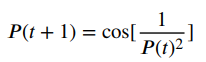

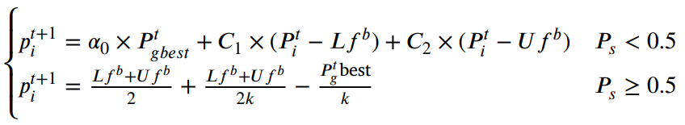
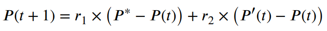
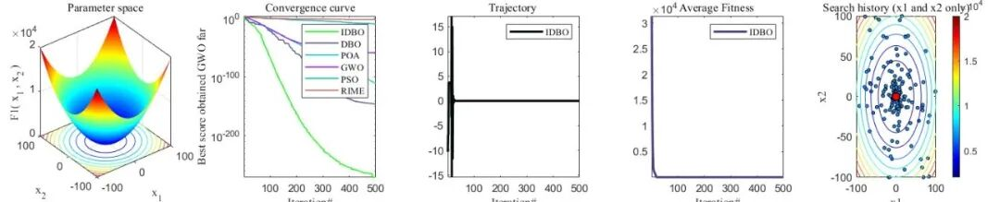
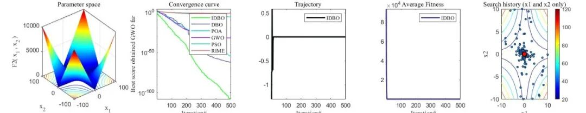
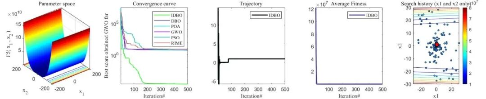
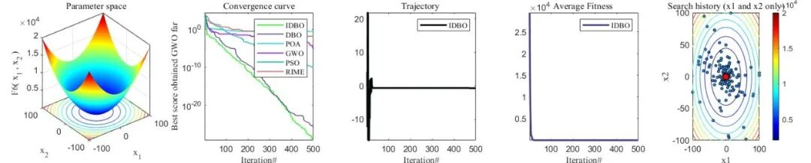
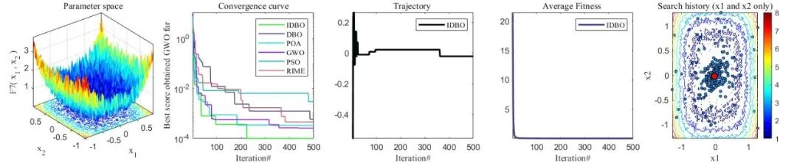
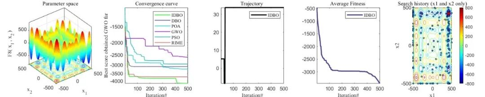
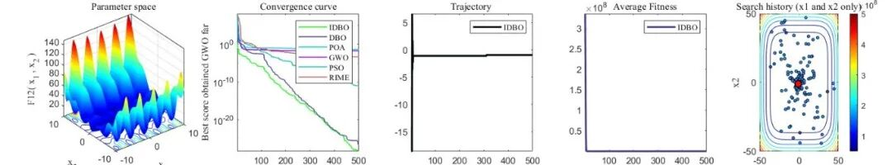
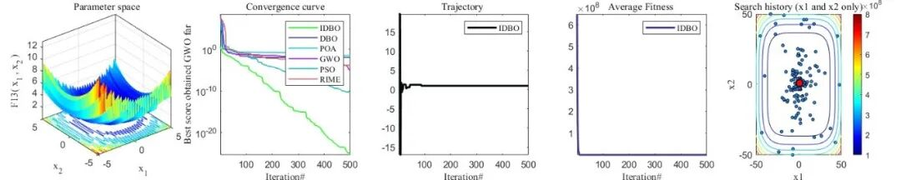
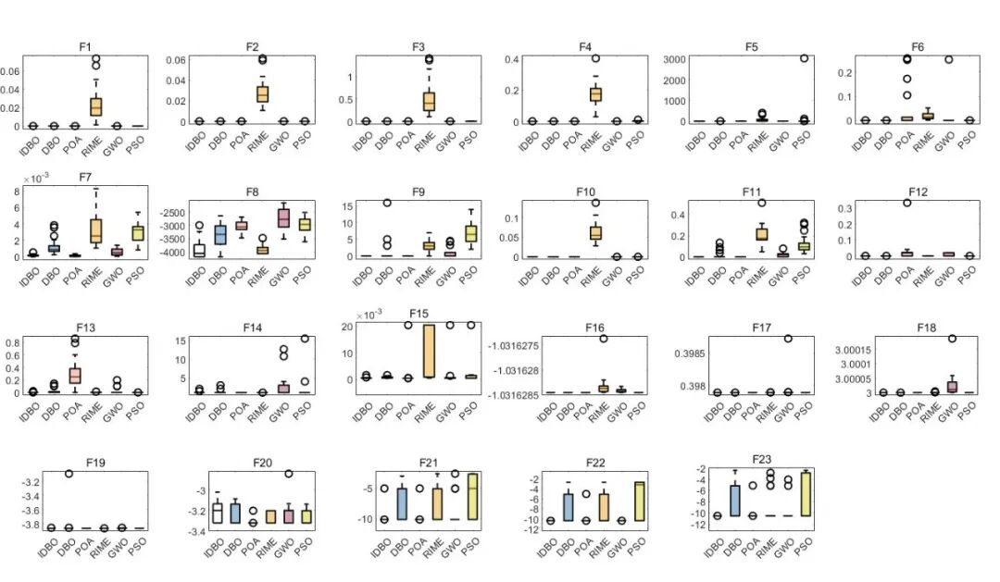
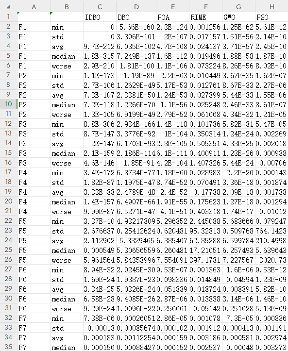

<!-- PAYMENT_BLOCK -->

## Get this dataset

- Payment link (Stripe): [Buy now](https://buy.stripe.com/3cs8yP7sY87d0vu9AB)
- Payment QR code: 

<!-- /PAYMENT_BLOCK -->
